# 3D view review of 2026-11-19

Owner request: make the 3D view look first class. The two UI reviews of the same day (`UI_REVIEW_2026-11-19.md`) polished everything round the view and left the view itself, because it is OpenGL and draws blank on the offscreen platform. This page is the review of the view, drawn on the owner's PC with its screen and graphics card, and a record of what changed on the `view-polish` branch. It is FDCAD's own review of FDCAD's own pictures. Nothing in it comes from another program (CLAUDE.md sections 7 and 10).

## How it was done

1. `tools/view_review_shots.py` opens the main window on the real screen and saves the view's own picture (`ViewportWidget.dump`, the kernel's frame), in Light and Dark: six sample parts (the nut and bolt, the enclosure, the sheet metal bracket, the turned shaft, the lofted handle, the tapped housing; the gearbox was drawn too, and left out of the tool because it takes two minutes to build), selected faces with the highlight under the cursor on three of them, a selected edge, a red part, the five display styles, the reference planes and the origin, the Extrude and Fillet previews, the corner triad, a sketch shown in the view and the sketch editor. Shots where line quality matters are also saved enlarged three times.
2. It was run on `origin/main` (`c085f2aa`) for the before pictures and on this branch for the after pictures, at 100 percent, and once at 200 percent to check sizes.
3. Each value was tried in turn (outline widths, edge widths, 4 and 8 samples, light strengths, see-through amounts, plates and halos for text) and the pictures compared before a number was kept.
4. Pixels were read where a claim is about a colour: the brightest face of a red part and of the grey part, and the contrast of a wireframe line.

Run it again with `uv run python tools/view_review_shots.py --out .shots/view`. A window opens for each theme and closes again. The `.shots` folder is ignored by git. Twelve before and after pairs are in `docs/screenshots/view_polish_2026-11-19/`.

## Verdict

The view's design was sound: a quiet gradient, a key and a fill light, dark edges, an outline, two highlight colours that are not the accent. What it showed was not always what the design says. Four things were wrong in a way a user sees at once (A1 to A4), and four more were clear gains at no cost to the look (B1 to B4). Everything else was judged and left (C). No theme colour was changed, and no preference stopped working.

## Findings

Each finding says what showed, why it costs polish, and the change. "Done" names the decision.

### A. Things that were wrong

**A1. A part was not drawn in its colour.** Every part. A part given the red `#C0392B` was salmon, (199, 114, 100) on its brightest face. The grey part `#B4BCC4`, which has a little blue in it by design, was a neutral (193, 197, 201). Sketches shown in the view were a paler blue than in the sketch editor. Why: the colour a user picks in Appearance is not the colour they get, and the cool cast of the Datum greys was lost in the one place it matters most. The colour went to the kernel as linear RGB, which the kernel lightened for the screen. Change: colours go as sRGB. With true colours the old lights left a part darker than its colour, so the three lights were set again: the brightest face in the isometric view is now 0.90 of the part's colour, and no face is brighter than the colour. The feature preview became more see through, since its true cobalt hid the part. Done, D2760. Measured after: red (183, 54, 40), grey (171, 179, 187).

**A2. Wireframe and the hidden line styles were all but blank in Light.** View, Display Style. The lines were drawn in the part's pale grey on the pale view, 1.2 to 1.8:1. In Hidden Lines Visible the dashed hidden edges were darker than the seen ones. In Dark the seen lines read but the hidden ones did not. Why: three of five display styles could not be used in the default theme. Change: lines with no face behind them take the outline colour, which is checked at 3:1 on the view; hidden edges fade from it. Done, D2761. Measured after, at mid height: 13.3:1 in Light, 6.0:1 in Dark. This closes the pair D745 left open, edges on the bare view. By the theme's colours, against the top and the bottom of the view, such a line was 1.55 and 1.17 in Dark and 1.27 and 1.56 in Stealth; it is 4.66 and 8.45 in Dark and 5.57 and 6.86 in Stealth now (15.96 and 10.58 in Light, 13.83 and 9.93 in Beige). The `edge` colour itself is unchanged: no colour is 3:1 on the grey part and on a dark view at once, so the view stopped using it where there is no face.

**A3. Text in the view was in a serif face.** The triad's X, Y and Z, plane names, values, the origin's letters. Why: U6.7 asks for the type scale; a second typeface in the middle of the window looked like a part of another program. Change: the kernel's text uses the window's font. Done, D2762.

**A4. The value beside a drag arrow could not be read.** Extrude and every tool with a handle. "40.00 mm" was blue text under the blue see-through preview, with the arrow across it. Why: it is the one thing the user reads while dragging. Change: values sit on a plate and are drawn after the preview. Done, D2763.

### B. Clear gains

**B1. One highlight colour looked like four.** Selected faces and the face under the cursor. The highlight was lit like the part, so burnt orange was brick on top and dark brown on a side face, and teal was grey green. No outline was drawn round a highlighted face. Why: U1.4 asks that selection read on any face and not by colour alone. Change: a flat tint of the theme's colour, 35 percent see through so the face's shading still shows, with the face's outline at 2.5 px (under the cursor) or 3 px (selected). Done, D2764.

**B2. A dot pattern between the turns of a thread.** The nut and bolt, and tight grooves. The outline round the part is a shell drawn behind it; at 2 px it cut into faces close by. Change: 1.5 px. Done, D2765. The outline is still heavier than an edge.

**B3. Planes weighed as much as the part.** Reference planes. A 1.5 px outline against the part's 1 px edges, and at 200 percent the outline and the plane's name stayed at 100 percent size. Change: 1 px, and both grow with the screen. Done, D2766.

**B4. The origin was white and yellow.** View, Origins. The kernel's own colours: white axes and yellow letters, lost on the light view, and not the colours the corner triad uses for the same axes. Change: the theme's axis colours and text colour. Done, D2766.

### C. Judged and left

**C1. Shading.** Faces read as solid. Curved faces are smooth: shading is worked out per pixel, and no facets show on the shaft, the handle or the fillets at the default display quality. There is no specular highlight to speak of, which suits engineering parts: a glint would move as the view turns and hide edges. Left.

**C2. Banding.** The background steps by one level of 255 in one channel at a time, about 120 steps over 586 px, the longest band 12 px in Light and 16 px in Dark. That is as smooth as an 8 bit screen shows. Shaded cylinders show no bands. Left.

**C3. Background.** A top to bottom gradient in every theme, exactly the theme's two colours at its ends (read from the pixels). The part separates from it at every height. Left.

**C4. Edge weight and colour.** 1 px dark edges on the faces read in both themes. At 1.5 px they are steadier but heavy on tangent edges; kept at 1 px.

**C5. Smoothing.** Four samples are on and working (with none, the same picture is jagged). Eight draw a thin line a little more evenly, at twice the memory of the view on every screen. Left at four; see P1.

**C6. The triad.** Three lit arrows in the axis colours, small, clear of the part at the default zoom. Only its letters changed (A3). It keeps a fixed size in device pixels; see P3.

**C7. The view cube and the sketch editor.** Both are drawn by Qt, not OpenGL, so the earlier reviews saw them. The sketch editor was looked at again here beside the view: lines, points, dimension plates, relation tags and the three state colours read in both themes, and the state colours are checked at 3:1 on the view by `contrast.pairs`. The grid is off by default and faint when on. Left.

## By topic

| Topic | Result |
| --- | --- |
| Shading and lighting | Colour was wrong (A1) and the lights were set again for the true colour. Smooth, no banding, no specular: right as they are (C1, C2) |
| Background | Right (C3) |
| Edges and outline | Outline thinner to end a fault (B2). Edge weight and colour kept (C4). Lines on the bare view fixed, hidden edges now clear (A2) |
| Selection and highlight | Flat tint and outline (B1). Colours and widths kept |
| Triad, cube, grid, planes | Triad letters (A3), planes (B3), origin (B4). Cube and grid left (C7) |
| Sketch drawing | Sketches in the view now have the sketch colour (A1). The editor left (C7) |
| Anti-aliasing | Four samples kept (C5) |

## Values, old and new

| What | Where | Old | New |
| --- | --- | --- | --- |
| Part, face, sketch, plane and preview colours | `ViewportWidget._hex` | linear RGB | sRGB |
| Ambient light | `look.LIGHTS` | 0.30 | 0.60 |
| Key light | `look.LIGHTS` | 0.72 | 0.78 |
| Fill light | `look.LIGHTS` | 0.26 | 0.32 |
| Preview see-through | `preview.PREVIEW_TRANSPARENCY` | 0.55 | 0.70 |
| Wireframe and seen lines | `look.style_part` | the part's colour | `silhouette` |
| Hidden lines fade from | `look.hidden_line_colour` | `edge` | `silhouette` |
| Wireframe body lines | `ViewportWidget._apply_body_modes` | `edge` | `silhouette` |
| Kernel text font | `look.use_ui_font` | serif, typewriter | the window's font |
| Value text | `look.style_value` | bare accent text | on a plate (`label_plate`, no alpha) |
| Text layer | `look.text_over_previews` | shares the depth | clears the depth |
| Highlight fill | `look.style_highlights` | lit | unlit |
| Highlight see-through | `look.HIGHLIGHT_TRANSPARENCY` | 0.15 | 0.35 |
| Highlighted face outline | `look.style_highlights` | none | 2.5 px and 3 px |
| Outline round the part | `look.SILHOUETTE_WIDTH` | 2.0 px | 1.5 px |
| Plane outline | `plane_look.OUTLINE_WIDTH` | 1.5 px, fixed | 1.0 px, times the screen scale |
| Plane name | `plane_look.LABEL_HEIGHT` | 12 px, fixed | 12 px, times the screen scale |
| Origin | `look.style_origin` | white and yellow | axis colours, 1.5 px |

Kept: `MSAA_SAMPLES` 4, `EDGE_WIDTH` 1.0, the highlight widths, every `Palette` colour.

## Found, not fixed

Two faults showed up while the view was driven by a script. Neither is about the look, so neither was changed here.

**F1. A 3D view can stop drawing after other parts are closed.** Open a part, then open and close other parts: after the sixth close, the first part's view could no longer make its drawing surface current ("wglMakeCurrent() has failed. The handle is invalid"), and one new view in three failed the same way. In 18 opens and closes with one part kept open, 13 checks failed. When the closed part's widgets were freed at once (a garbage collection run from the tab's `destroyed` signal) none failed in 18. The kernel view of a closed part is freed later, by the collector, and by then it seems to take something a live view uses. The script closes parts much faster than a person, so this may be rare by hand; it is worth a proper look. The review tool freed closed parts at once for this reason. Fixed later the same day: a closed part's view is now freed when its tab closes, before its window goes (D2780).

**F2. `ViewportWidget.detected_at` returns the whole part.** It asks the kernel for the "detected shape", which is the part itself, not the face or edge under the cursor. Select Other, the view's right click menu and Paste on a face all read it. The owner of each detected item holds the right shape. Fixed later the same day: the shape is read from the owner (D2781).

## Proposed, not done

**P1. Eight samples on screens at 100 percent.** Thin lines are a little steadier with eight. It doubles the memory of the view, so it would need a measurement on a small graphics card first, or a Preferences choice.

**P2. A second outline for highlights on parts of a near colour.** A red part's selected face is burnt orange on red: the tint is weak and only the outline shows. A thin light or dark line beside the outline would read on any colour. It adds a line style, so it is the owner's call.

**P3. The triad grows with the screen.** The kernel draws it at a fixed size in device pixels, so at 200 percent it is half size. Changing it means the click areas of `viewport/triad.py` (D1600) scale too.

**P4. Wireframe without the kernel's extra curves.** Wireframe shows one extra line across each curved face (a ring on a hole, an arc on a fillet). They are the kernel's own and help a sphere read, but on fillets they are noise. Proposal: off, with the outline of curved faces drawn as in the hidden line styles.

**P5. Other line widths at 200 percent.** Sketches shown in the view (2 px), reference curves (2 px) and marks (3 px) are fixed in device pixels. They should grow with the screen like edges, planes and values now do.

**P6. See-through amounts of regions, the mirror image and the graph ghost.** They were tuned while their colours arrived paler than they are (A1). Only the feature preview was looked at and changed. The others want the same look with their tools open.

## The proposals, closed on 2026-11-20

The owner approved closing all six. Each was drawn on the same PC before and after (`tools/view_review_shots.py --only near,corner,wire,widths,see`, at 100 and 200 percent), and measured where a number could be had. The decisions are D2820 to D2826.

| | What was done | Old | New |
| --- | --- | --- | --- |
| P1 | Eight smoothing samples below 150 percent, on a graphics card that tells its memory and has room (D2820). In part: built in graphics and the Mac keep four | 4 samples everywhere | 8 or 4 (`look.msaa_samples`) |
| P2 | A rim beside the outline of a highlight: white in the light themes, black in the dark ones (D2821) | outline only | outline and a 1 px rim each side |
| P3 | The triad, its letters and its click areas grow with the screen scale (D2822) | arrows of 26 px and letters of 16 px at any scale | times the scale |
| P4 | Wireframe draws real edges only (D2823). In part: no outline down the sides of curved faces, see below | one kernel curve each way across every curved face | none |
| P5 | Sketches, reference curves and marks grow with the screen scale (D2824) | 2, 3 and 4 device pixels | 2, 3 and 4 px times the scale |
| P6 | Region amounts changed, the mirror image drawn with its edges, the graph ghost kept (D2825) | regions 0.90, 0.70, 0.45, 0.35; mirror image a see-through fill | regions 0.85, 0.70, 0.45, 0.30; mirror image a fill with edges |

**P1, measured.** On this PC (1680 by 1050 at 100 percent, a GeForce GTX 1050 Ti with 4 GiB), the nut and bolt turning, the screen's frame lock off:

| View, pixels | Samples | Graphics memory more than with none | Frame time, mean |
| --- | --- | --- | --- |
| 1176 by 597 | 0 | 0 | 1.41 ms |
| 1176 by 597 | 4 | 31 MiB | 2.13 ms |
| 1176 by 597 | 8 | 77 MiB | 2.95 ms |
| 1416 by 728 | 0 | 0 | 1.62 ms |
| 1416 by 728 | 4 | 52 MiB | 2.52 ms |
| 1416 by 728 | 8 | 119 MiB | 3.84 ms |

A sample of a pixel costs 16 bytes, so eight samples cost a view 64 bytes a pixel more than four. The spread of ink along the thin lines of a box in Wireframe (lower is steadier; Light, then Dark):

| Scale | 4 samples | 8 samples |
| --- | --- | --- |
| 100 percent | 0.216, 0.132 | 0.154, 0.095 |
| 125 percent | 0.219, 0.120 | 0.145, 0.075 |
| 150 percent | 0.110, 0.118 | 0.106, 0.072 |
| 200 percent | 0.130, 0.081 | 0.085, 0.062 |

Below 150 percent eight samples are a quarter to a third steadier. From 150 percent four samples are already about where eight are at 100 percent, and a view has 2.25 to 4 times the pixels. So eight are used below 150 percent, and only on a card that says how much memory it has and where the extra costs a view no more than a sixteenth of it. Built in graphics do not say, and the Mac is not asked. Both keep four: nothing was measured on such a machine, and there the buffers come out of the machine's own memory.

**P4, why no outlines.** The hidden line styles outline curved faces because the kernel works the outlines out again for every frame. A frame of them takes 9 ms on the enclosure, 77 ms on the nut and bolt and 179 ms on the 200 feature part; a frame of Wireframe takes 2 ms. Wireframe stays the fast still drawing it was. Outlines worked out in the background when the view rests are IDEAS item 86.

**P6, measured.** The kernel mixes a see-through item with what is under it in linear light; pixels match that to one step, so the amounts were worked out for all four themes (`look.seen_through`). The measure is the colour gap in CIE L*a*b*, where about 2 is the least step an eye sees and 10 is plain. Regions: the smallest step between two states was 3.5 (idle, dark themes) and is now 5.8. Mirror image: its faces stand 9.5 or more off the view, but on the light themes its top and front face were 0.9 apart at any amount, a flat shadow, so it got its edges. Graph ghost: 12.9 or more off the view, 14 to 19 over the part, kept.

Six pairs in `docs/screenshots/view_proposals_2026-11-20/`:

| What | Before | After |
| --- | --- | --- |
| P1: thin lines in Wireframe, Dark, four times the size, with 4 and with 8 samples | 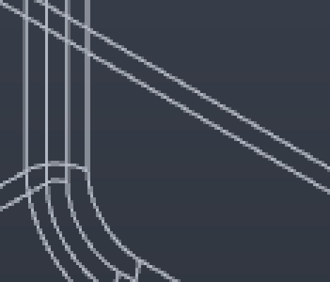 | 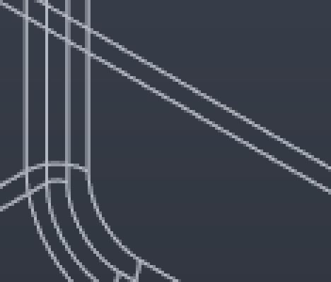 |
| P2: two selected faces and the face under the cursor on a red part, Light | 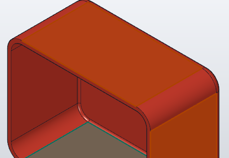 | 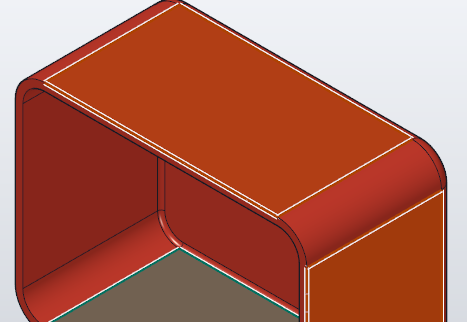 |
| P3: the corner of the view at 200 percent, Dark | 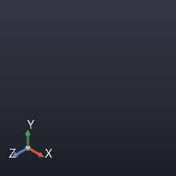 | 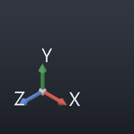 |
| P4: the enclosure in Wireframe, Light | 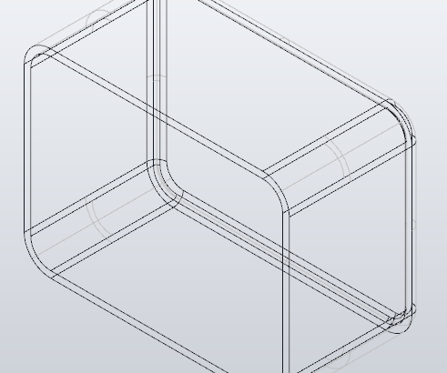 | 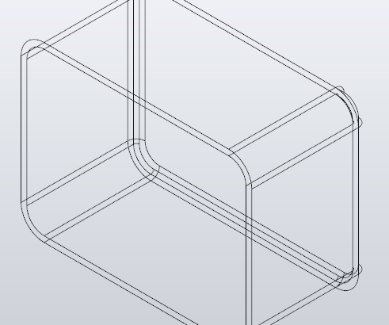 |
| P5: sketches, a reference curve and marks at 200 percent, Dark | 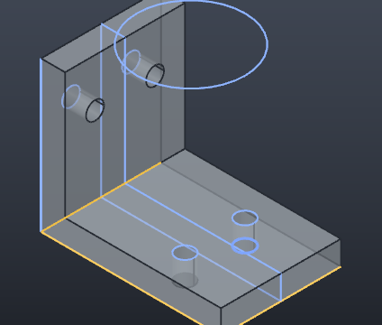 | 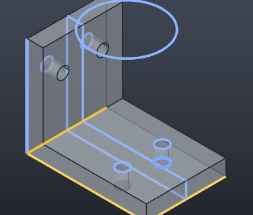 |
| P6: the mirror image, Light | 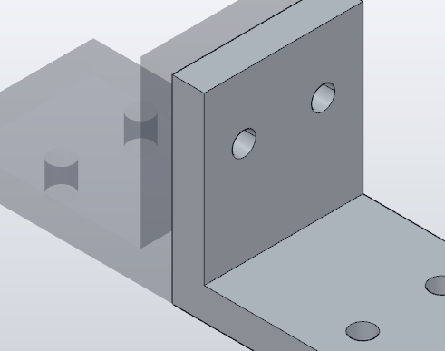 |  |

## Before and after

Twelve pairs in `docs/screenshots/view_polish_2026-11-19/`, at 100 percent. The full sets are made by `tools/view_review_shots.py`.

| What | Before | After |
| --- | --- | --- |
| A red part, Light (A1) | 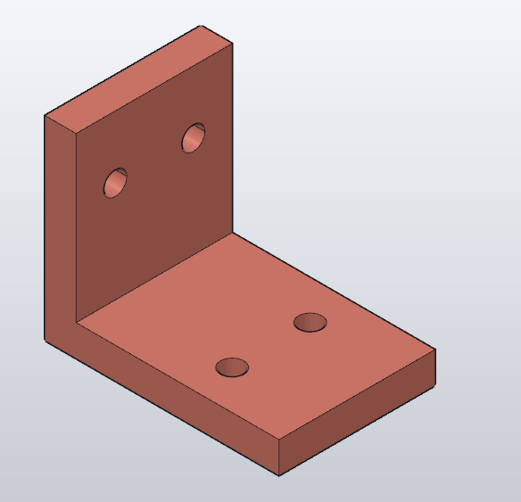 | 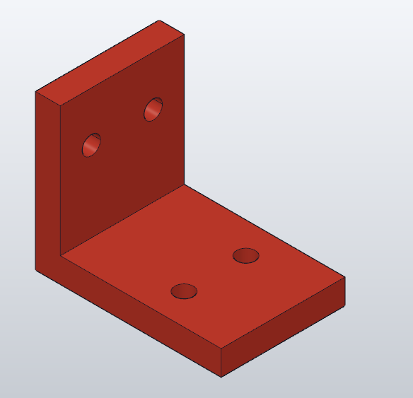 |
| A red part, Dark (A1) | 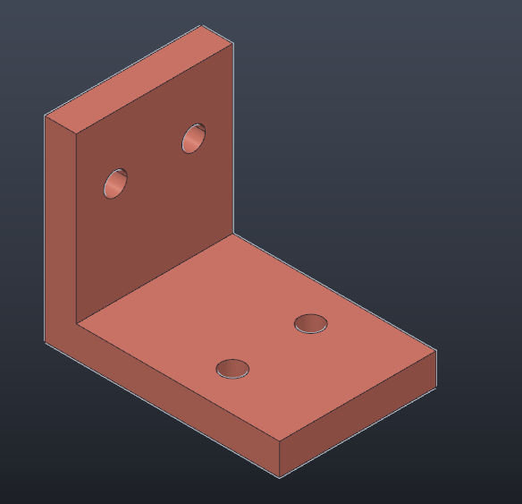 | 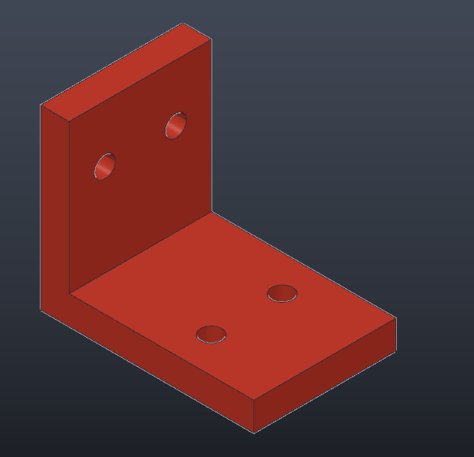 |
| Hidden Lines Visible, Light (A2) | 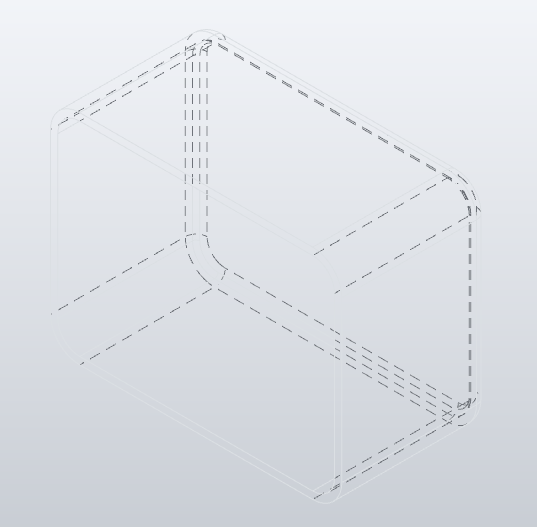 | 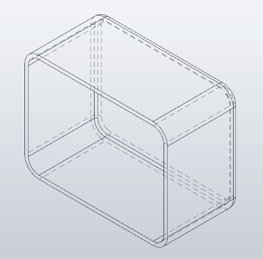 |
| Hidden Lines Visible, Dark (A2) | 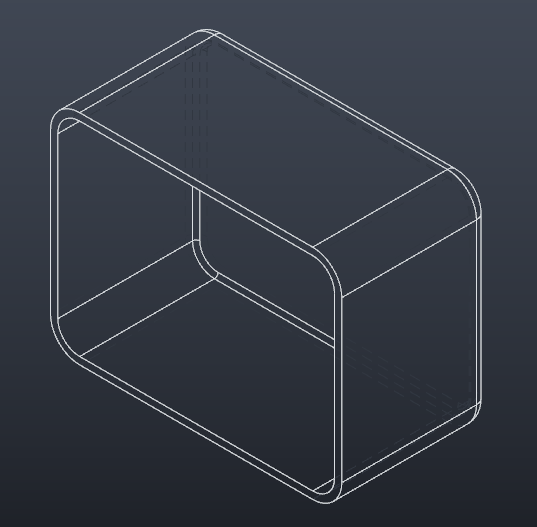 | 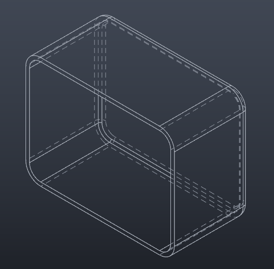 |
| Planes and their names, Light (A3, B3) | 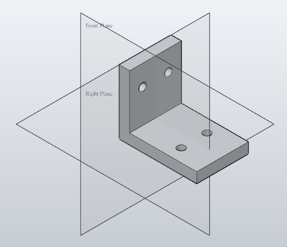 | 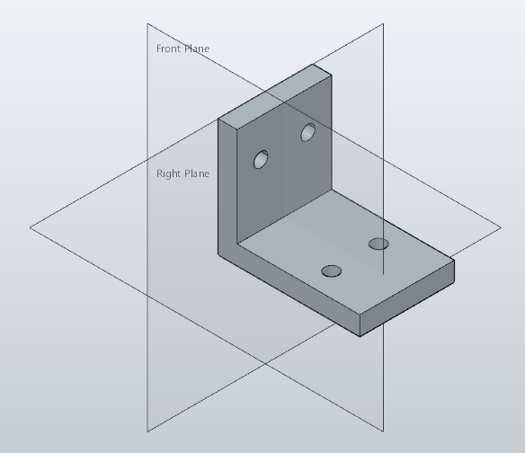 |
| The origin in wireframe, Dark, twice the size (A2, B4) | 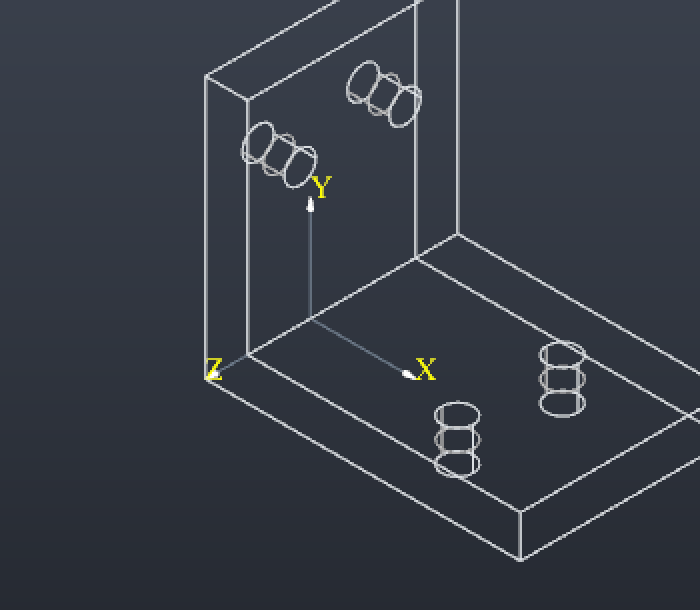 | 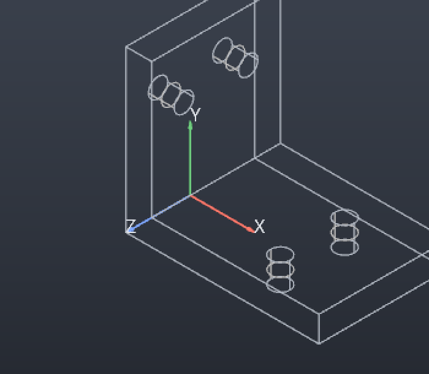 |
| The depth beside the Extrude arrow, Light (A4) | 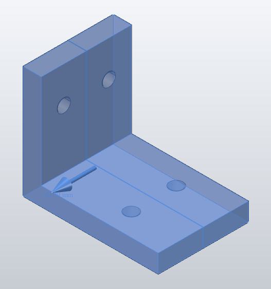 | 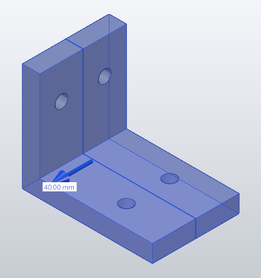 |
| The radius of a Fillet preview, Dark (A4) | 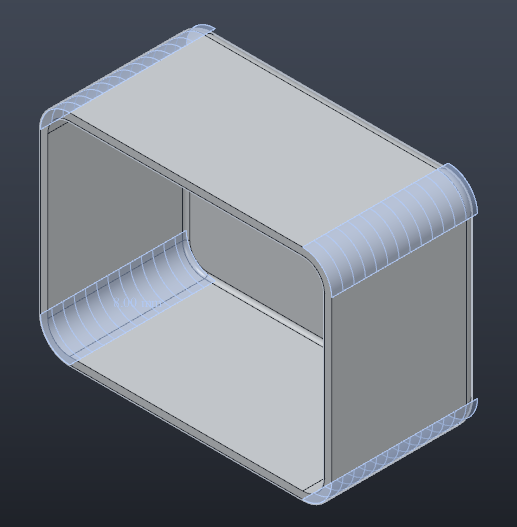 | 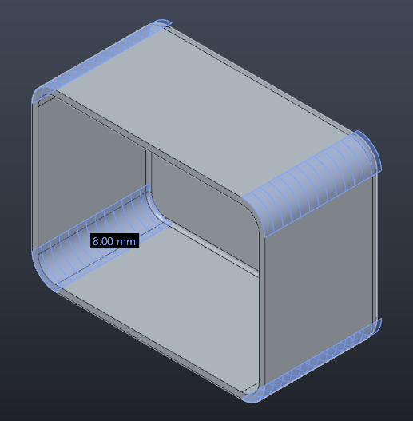 |
| Two selected faces and the face under the cursor, Light (B1) | 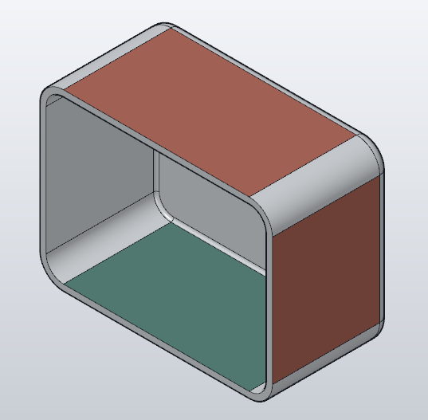 | 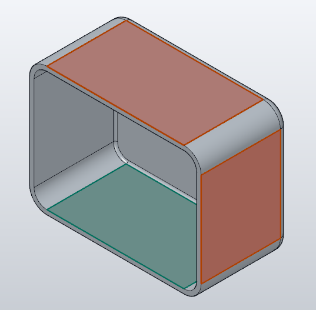 |
| The same on a turned shaft, Dark (B1) | 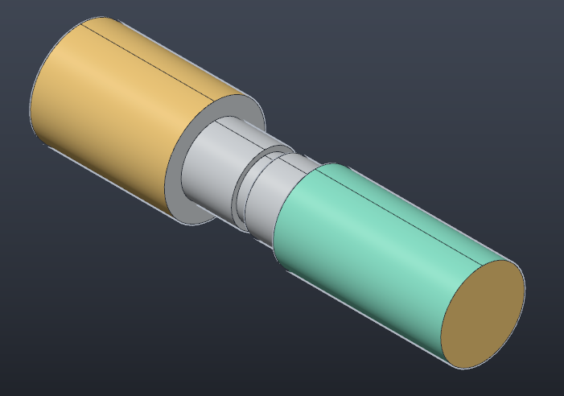 | 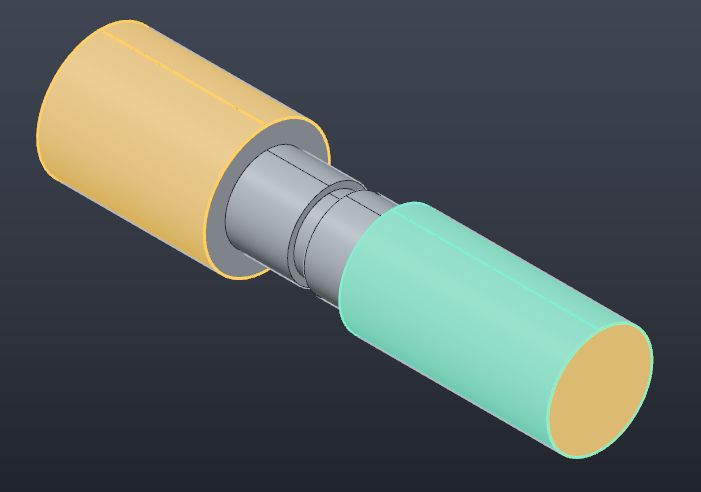 |
| A thread, Light, three times the size (B2) | 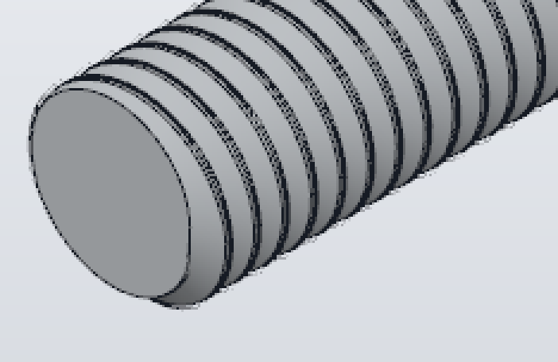 | 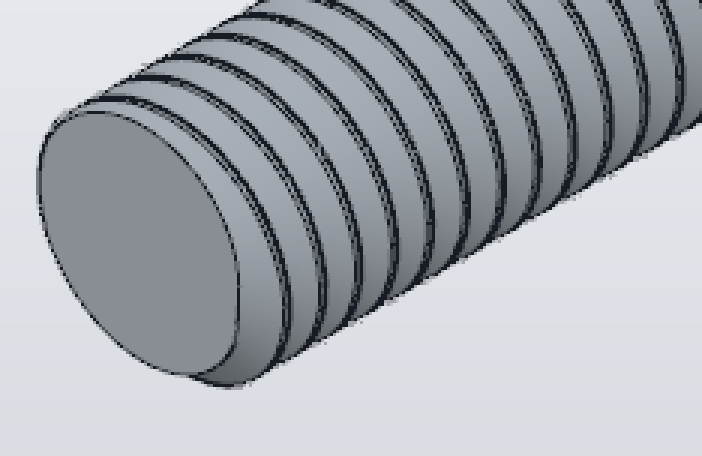 |
| The corner triad, Dark, four times the size (A3) | 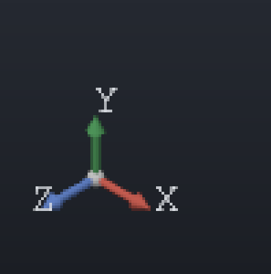 | 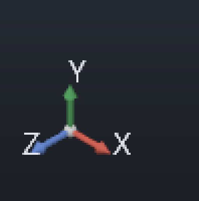 |
